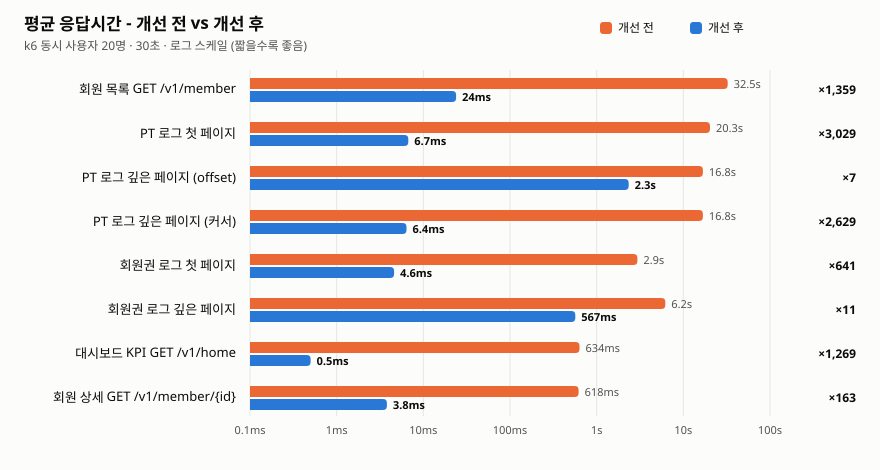
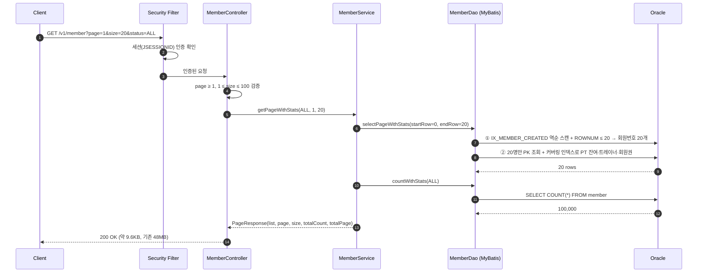
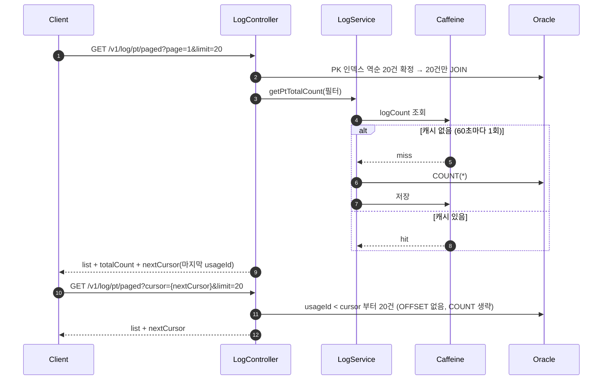

# GymErp Backend

헬스장 운영(회원·회원권·PT·일정·판매·재고·근태)을 관리하는 ERP 백엔드입니다.
9인 팀 프로젝트(Acorn 파이널 프로젝트)를 fork 하여, **대용량 데이터 기준 성능 개선**과 보안·코드 품질 정리를 혼자 진행했습니다.

| 구분 | 기술 |
|---|---|
| Language / Framework | Java 17, Spring Boot 3.5, Spring Security (세션 인증) |
| Persistence | MyBatis 3 (XML Mapper), Oracle Database |
| Cache | Caffeine (Spring Cache) |
| Test | JUnit 5, MockMvc, `@MybatisTest` + H2(Oracle 모드), GitHub Actions |
| Performance | k6 (부하 테스트), Oracle 실행계획(DBMS_XPLAN) |
| Docs | springdoc-openapi (Swagger UI: `/swagger-ui.html`) |

---

## 아키텍처

```mermaid
flowchart LR
    C[Client<br/>Swagger / k6] -->|HTTPS| N[Nginx<br/>Reverse Proxy]
    N --> S

    subgraph S[Spring Boot :9000]
        direction LR
        F[Security Filter<br/>세션 인증 · CORS] --> CT[Controller<br/>@Valid 검증]
        CT --> SV[Service<br/>@Transactional]
        SV <-->|"@Cacheable<br/>KPI · 목록 COUNT"| CA[(Caffeine<br/>Local Cache)]
        SV --> D[DAO<br/>MyBatis SqlSession]
        CT -. 예외 .-> GE[GlobalExceptionHandler<br/>공통 JSON 에러]
    end

    D -->|JDBC · HikariCP| DB[(Oracle)]
    SV --> FS[[업로드 디렉터리<br/>프로필 이미지]]
```

- **요청 흐름**: Security Filter(세션 확인) → Controller(입력 검증) → Service(트랜잭션·캐시) → DAO(MyBatis) → Oracle
- **에러 응답**: 모든 예외는 `GlobalExceptionHandler`에서 `{status, message, errors}` 형식으로 변환 (검증 실패 400 / 로그인 실패 401 / 상태 충돌 409)

---

## 성능 개선

### 결과 요약

<picture>
  <source media="(prefers-color-scheme: dark)" srcset="docs/images/latency-dark.svg">
  
</picture>

| API | 개선 전 평균 (p95) | 인덱스만 추가 | **개선 후 평균 (p95)** | 처리량 (RPS) | 실패율 |
|---|---|---|---|---|---|
| 회원 목록 `GET /v1/member` | 32.5s (49.4s) | 24.9s | **23.9ms (24.4ms)** | 0.5 → 826 | 3.3% → 0% |
| PT 로그 첫 페이지 | 20.3s (31.8s) | 28.1s | **6.7ms (7.0ms)** | 0.9 → 2,940 | 0% |
| PT 로그 깊은 페이지 (offset 90만) | 16.8s (23.7s) | 27.5s | **2.3s (3.3s)** | 1.1 → 8.4 | 0% |
| └ 같은 위치를 커서(키셋)로 조회 | 16.8s | - | **6.4ms (6.4ms)** | 1.1 → 3,059 | 0% |
| 회원권 로그 첫 페이지 | 2.9s (4.5s) | 5.3s | **4.6ms (4.9ms)** | 6.6 → 4,216 | 0% |
| 회원권 로그 깊은 페이지 (offset 25만) | 6.2s (9.9s) | 5.8s | **567ms (1.2s)** | 3.1 → 35 | 0% |
| 대시보드 KPI `GET /v1/home` | 634ms (1.4s) | 165ms | **0.5ms (2ms)** | 31 → 28,797 | 0% |
| 회원 상세 `GET /v1/member/{id}` | 618ms (1.0s) | 3.7ms | **3.8ms (5.7ms)** | 32 → 5,061 | 0% |

- **인덱스만 추가**했을 때 회원 상세·대시보드는 빨라졌지만, 목록/페이징 API는 그대로이거나 오히려 느려졌습니다. 쿼리가 "필요한 만큼만 읽고 멈추는" 구조가 아니었기 때문이고, 그래서 쿼리·API 구조를 함께 바꿨습니다.
- 회원 목록은 개선 전 동시 20명에서 **DB 커넥션 대기 타임아웃(30초)으로 요청 3.3%가 실패**했고, 개선 후에는 실패가 없습니다.
- 회원권 로그는 개선 전 쿼리가 **잘못된 결과를 반환하는 버그**가 있었습니다(아래 4번). 개선 후 수치는 올바른 정렬 결과 기준입니다.

### 테스트 조건

| 항목 | 내용 |
|---|---|
| 서버 | Intel Core Ultra 5 125H (14코어/18스레드), RAM 16GB, Windows 11 — 앱·DB·k6 동일 장비 |
| DB | Oracle Database XE 11g R2 (XE 제약: CPU 1코어, 메모리 1GB) |
| 애플리케이션 | JDK 17, 힙 `-Xms512m -Xmx512m`, HikariCP 기본 풀 10, Tomcat 기본 스레드 200 |
| 데이터 | 회원 10만 · PT 로그 100만 · 회원권 30만 · 서비스 판매 30만 · 상품 판매 30만 · 직원 50 ([perf/sql/02_seed.sql](perf/sql/02_seed.sql), 재현 가능한 결정적 데이터) |
| 부하 | k6 closed model, **동시 사용자(VU) 20명, think time 없이 30초 연속 요청**, 시나리오별 단독 실행 ([perf/k6/api.js](perf/k6/api.js)) |
| 측정 | 평균·p95 응답시간, 처리량(RPS), 실패율 — 결과 원본 [perf/results](perf/results) |
| 비교 방법 | 같은 장비·데이터에서 ① 개선 전 ② 인덱스만 추가(코드 동일) ③ 쿼리·코드 개선 순서로 측정 |

---

### 문제와 해결

#### 1. 회원 목록: 요청마다 전체 데이터 집계 + 페이징 없음 → 32.5s → 23.9ms

**문제**
- `GET /v1/member`가 페이징 없이 **회원 10만 명 전체(응답 48MB)** 를 반환
- 회원별 PT 잔여·담당 트레이너·최신 회원권을 구하려고 요청마다 `pt_log` 100만 건, `voucher_log` 30만 건을 **전부 GROUP BY**
- FK 컬럼에 인덱스가 없어 모두 Full Scan (Oracle은 FK에 인덱스를 자동 생성하지 않음)
- 느린 쿼리가 커넥션 10개를 오래 점유 → 동시 20명에서 **커넥션 획득 타임아웃으로 요청 실패**

**해결**
| 비교한 방법 | 결과 | 판단 |
|---|---|---|
| 인덱스만 추가 | 32.5s → 24.9s, 실패율 25% | 전체 집계·48MB 응답은 그대로라 효과 미미 |
| 페이징 + 기존 CTE(전체 집계 후 정렬) 유지 | 단건 0.25s, 동시 20명 4.2s | 페이지마다 30만 건 집계 + 10만 건 정렬이 남음 |
| **지연 조인(Deferred Join) + 페이지 회원만 통계 조회** | **23.9ms** | 채택 |

- `member(memCreated, memNum)` 인덱스를 역순으로 읽어 **회원번호 20개만 먼저 확정**(`ROWNUM` 스톱키) → 그 20명만 회원 테이블 조회
- PT 잔여/트레이너/회원권은 **20명에 대해서만** 스칼라 서브쿼리로 조회하고, 필요한 컬럼을 모두 담은 **커버링 인덱스** `pt_log(memNum, createdAt, usageId, empNum, countChange)`로 테이블 접근 없이 계산
- 상태 필터(사용중/미사용중)는 최신 회원권 전체 집계 대신 `EXISTS (유효 회원권)`으로 판단 — 의미는 동일
- `size`는 최대 100으로 제한해 전체 조회 자체를 차단
- 트레이드오프: 정렬을 "미사용중 우선 → 최신 가입순"에서 **"최신 가입순 + 상태 탭 필터"** 로 변경 (상태별 탭이 있어 우선 정렬은 중복 기능)

```
개선 전 실행계획 (일부)                          개선 후 실행계획
HASH JOIN OUTER                                  NESTED LOOPS
  TABLE ACCESS FULL   MEMBER        100K           VIEW
  VIEW (GROUP BY)     PT_LOG       1000K             COUNT STOPKEY
  VIEW (WINDOW SORT)  VOUCHER_LOG   300K               INDEX FULL SCAN DESCENDING  IX_MEMBER_CREATED   20 rows
SORT ORDER BY                       100K            INDEX UNIQUE SCAN  (MEMBER PK)
                                                   + 20명 × INDEX RANGE SCAN  IX_PTLOG_MEM_COVER
```

#### 2. 로그 페이징: 20건을 보여주려고 100만 건 JOIN·정렬 → 20.3s → 6.7ms

**문제** — PT 로그 목록 쿼리가 `pt_log` 100만 건 전체에 member·employee를 JOIN하고 정렬한 뒤, 바깥에서 `rn BETWEEN`으로 20건만 잘라냄. `ROWNUM <= N` 스톱키가 없어 첫 페이지도 전체를 처리 ([실행계획 원본](perf/results/plan-ptlog-before.txt), Cost 15,289)

**해결 과정**
1. `ROWNUM <= :마지막행` 스톱키 추가 → SQL*Plus에서는 0.00s인데 **앱에서는 여전히 1.3s**
2. 원인 추적: 앱은 `ROWNUM <= #{offset} + #{limit}` 처럼 **바인드 변수 두 개의 식**을 넘기고 있었음. 같은 쿼리를 바인드 변수로 재현하니 0.43s — 옵티마이저가 식의 값을 알 수 없어 스톱키를 활용하지 못하고 Full Scan 계획을 선택
3. 서버에서 `endRow`를 계산해 **단일 바인드**로 전달 → 0.02s
4. 하지만 힌트로 인덱스 순서 읽기를 강제하자 **offset 90만 같은 깊은 페이지는 오히려 악화**(16.8s → 32s, 실패율 48%): 90만 건마다 테이블 접근·JOIN 후 버리기 때문
5. **지연 조인**으로 변경: PK 인덱스만 읽어 해당 페이지의 `usageId` 20개를 확정한 뒤 그 20건만 JOIN → 깊은 페이지 2.3s, 첫 페이지 6.7ms (Cost 15,289 → 68)
6. 깊은 페이지가 필요한 "더 보기/무한 스크롤"용으로 **커서(키셋) 페이징** 추가: `?cursor={직전 마지막 usageId}` → `usageId < cursor`부터 바로 읽어 **페이지 깊이와 무관하게 6.4ms**

#### 3. 목록 전체 건수(COUNT)와 대시보드 KPI: 같은 값을 매번 다시 계산 → 634ms → 0.5ms

**문제**
- 페이지를 넘길 때마다 `COUNT(*)` (PT 로그 100만 건)를 다시 실행 — 지연 조인 후 남은 비용의 대부분 (첫 페이지 431ms → 커서 방식은 COUNT가 없어 6ms)
- 홈 화면 KPI가 진입할 때마다 회원권·회원·서비스 매출·상품 매출 4개 테이블을 집계 (인덱스 추가 후에도 165ms)

**해결**
- 날짜 범위 조회용 인덱스(`createdAt`, `endDate`) 추가
- **Caffeine 로컬 캐시**(TTL 60초) 적용: KPI는 `dashboardKpi`, 목록 COUNT는 필터 조합을 키로 `logCount`에 캐시
- Redis 대신 Caffeine을 고른 이유: 단일 서버 배포라 분산 캐시가 필요 없고, 네트워크 왕복 없이 가장 빠름. 서버를 늘리면 Redis로 교체
- 트레이드오프: 최대 60초까지 이전 값이 보일 수 있음 — 매출·회원 수 KPI와 목록 총 건수는 초 단위 정확도가 필요하지 않다고 판단

#### 4. 회원권 로그 페이징 버그: 페이지를 넘겨도 정렬이 이어지지 않음

**문제** — `ROWNUM`을 `ORDER BY`와 같은 쿼리 블록에서 사용해, Oracle이 **정렬 전에 번호를 매김**. 그 결과 각 페이지가 "임의의 20건을 페이지 안에서만 정렬"한 결과가 되어 회원명 순서가 페이지 사이에서 이어지지 않았음 (개선 전 응답이 빨랐던 것도 정렬을 사실상 하지 않았기 때문)

**해결** — 정렬을 서브쿼리 안에서 끝낸 뒤 `ROWNUM`을 부여하도록 수정하고, 올바른 정렬을 유지하면서도 빠르도록 `voucher_log(memberName, voucherId)` 인덱스 + 지연 조인 적용 → 첫 페이지 4.6ms, 깊은 페이지 567ms

### 회원 목록 조회 시퀀스 (개선 후)



### PT 로그 커서 페이징 시퀀스



---

## 그 외 개선

- **보안**: DB 접속 정보 환경변수화, 업로드 이미지 경로 조작(`../`) 차단, 테스트용으로 열려 있던 API 인증 적용, 미인증 401 JSON 응답, 로그인 시 세션 재발급(세션 고정 공격 방지)
- **품질**: 전역 예외 처리, Bean Validation(`@Valid`), `System.out` → SLF4J, 업로드 로직 서비스 분리(확장자 화이트리스트)
- **테스트**: `mvn test`가 테스트를 건너뛰던 설정 제거, `@MybatisTest`가 Oracle 모드가 아닌 H2로 바뀌던 문제 수정, 회원·로그인·이미지 테스트 추가

## 실행 방법

```bash
# 환경변수 (또는 src/main/resources/application-local.properties.example 참고)
export DB_URL=jdbc:oracle:thin:@localhost:1521:xe
export DB_USERNAME=...
export DB_PASSWORD=...
export FILE_LOCATION=./profile   # 업로드 디렉터리

./mvnw spring-boot:run           # http://localhost:9000/swagger-ui.html
./mvnw test -Dspring.profiles.active=test
```

### 성능 테스트 재현

```bash
sqlplus user/pw@//localhost:1521/XE @perf/sql/01_schema.sql   # 측정용 스키마 (PK 외 인덱스 없음)
sqlplus user/pw@//localhost:1521/XE @perf/sql/02_seed.sql     # 대용량 데이터 (약 15초)
k6 run -e SCENARIO=member -e LABEL=before perf/k6/api.js      # 개선 전 측정
sqlplus user/pw@//localhost:1521/XE @perf/sql/03_indexes.sql  # 인덱스 적용
k6 run -e SCENARIO=member -e LABEL=after perf/k6/api.js       # 개선 후 측정
python perf/charts.py                                          # 비교 차트 생성
```

로그인 계정(시드 데이터): `admin@gym.local` / `perf1234`
